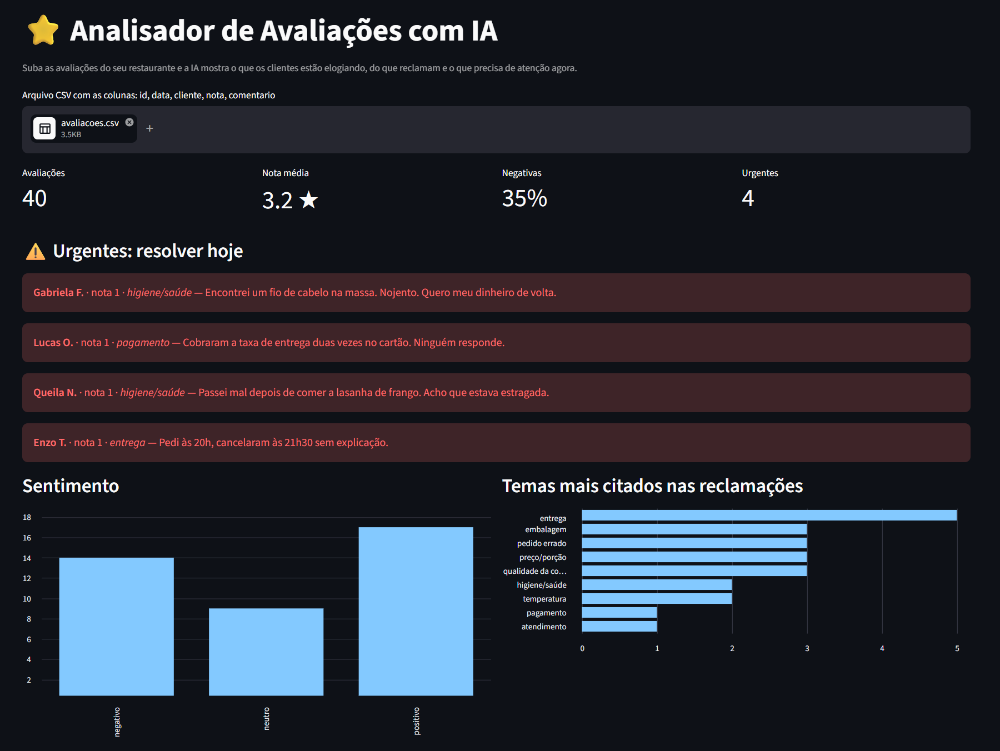
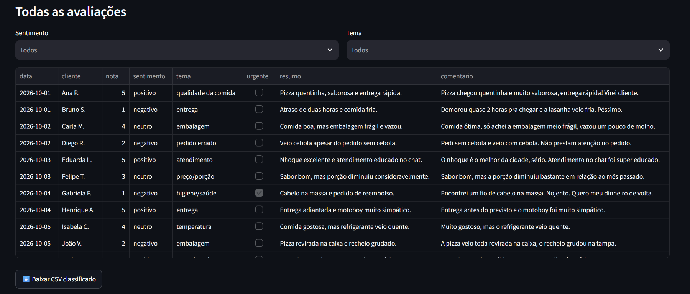

# ⭐ Analisador de Avaliações com IA

Painel para donos de restaurante: você sobe as avaliações dos clientes e a **IA (Google Gemini)** classifica cada uma por **sentimento, tema e urgência**, mostra **o que mais gera reclamação** e **sugere respostas** para as avaliações negativas.

> Projeto de portfólio, desenvolvido com *vibe coding* (código gerado com assistente de IA e revisado por mim). As avaliações de exemplo são fictícias.



## O problema

Um restaurante de delivery recebe dezenas de avaliações por semana. Ler uma por uma para descobrir **o que está dando errado** (atraso? comida fria? embalagem?) toma tempo. E as reclamações graves, como um cliente que passou mal ou foi cobrado duas vezes, se perdem no meio dos elogios.

## A solução

1. O dono sobe um CSV com as avaliações (`id, data, cliente, nota, comentario`).
2. O Gemini classifica cada avaliação:
   - **sentimento:** positivo, neutro ou negativo;
   - **tema:** entrega, qualidade da comida, temperatura, embalagem, atendimento, preço/porção, pedido errado, higiene/saúde, pagamento ou outro;
   - **urgente:** marca casos de saúde, higiene, cobrança indevida ou cancelamento;
   - **resumo:** a reclamação em até 10 palavras.
3. O painel mostra:
   - indicadores: total, nota média, % de negativas, urgentes;
   - **⚠️ urgentes em destaque**, para resolver no mesmo dia;
   - gráficos de sentimento e dos **temas mais citados nas reclamações**;
   - tabela filtrável e download do CSV classificado.
4. Para cada avaliação negativa, o botão **"Sugerir resposta"** gera uma resposta educada e empática, que o dono pode editar antes de publicar.



## Decisões técnicas

- **Classificação em lotes:** as avaliações vão em lotes de 20 por chamada, em vez de uma por vez. Para 40 avaliações são 2 chamadas em vez de 40, o que economiza cota e evita o limite do plano gratuito.
- **Saída estruturada:** o modelo responde em JSON (`response_mime_type="application/json"`) com uma lista fechada de temas. Assim os resultados podem ser agrupados e viram gráficos confiáveis.
- **Resiliência:** os erros temporários da API (429 e 5xx) têm novas tentativas com espera crescente, e existe um **modelo reserva** caso o principal esteja sobrecarregado.
- **Cache:** o mesmo arquivo não é classificado duas vezes (`st.cache_data`).
- **Segurança:** a chave da API fica no `.env`, que não vai para o GitHub (`.gitignore`).
- **Respostas sem promessas:** o prompt proíbe prometer reembolso ou inventar informações sobre o restaurante.

## Ferramentas

`Python` · `Streamlit` · `pandas` · `Google Gemini API` · engenharia de prompt · saída estruturada (JSON)

## Como rodar

```bash
pip install -r requirements.txt
```

Crie um arquivo `.env` (veja o `.env.example`):

```
GEMINI_API_KEY=sua_chave_do_google_ai_studio
```

```bash
streamlit run app.py
```

O painel abre no navegador. Suba o `avaliacoes.csv` de exemplo.

## Próximos passos

- [ ] Ler as avaliações direto de uma planilha do Google Sheets.
- [ ] Comparar períodos (esta semana × semana passada).
- [ ] Enviar um resumo semanal automático para o dono (por exemplo, via n8n + Telegram).

---

Feito por **Rafael da Silveira Gonçales** · [LinkedIn](https://www.linkedin.com/in/rafaelgoncales) · [GitHub](https://github.com/Rafael8353)
